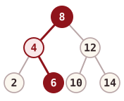

<h1 id="top">
  
  <picture>
    <source media="(max-width: 600px) and (prefers-color-scheme: dark)" srcset="assets/readme/intro-title-compact-dark.svg">
    <source media="(max-width: 600px)" srcset="assets/readme/intro-title-compact-light.svg">
    <source media="(prefers-color-scheme: dark)" srcset="assets/readme/intro-title-dark.svg">
    
  </picture>
</h1>

**A notes bank by UBIT students, for this batch and the next.**

When I study a difficult course, I make notes and share them in **The UBIT Hub**, the WhatsApp community I run for students at the University of Karachi. My friends share theirs too. But PDFs get lost in chats, and someone has to ask for the same file again. Here, you can find those notes even when we’re offline.

Keep up with a course, revise before an exam, or start learning during the semester break. Students from **any UBIT batch or program** are welcome to use the notes and share their own.

<p>
  <a href="#find-your-course">Courses</a>&nbsp;·
  <a href="#how-to-use-this-repo">How&nbsp;to&nbsp;use</a>&nbsp;·
  <a href="#the-dsa-blueprint">DSA&nbsp;Blueprint</a>&nbsp;·
  <a href="#ubit-results-portal">Results&nbsp;&amp;&nbsp;GPA</a>&nbsp;·
  <a href="#help-improve-the-library">Contribute</a>&nbsp;·
  <a href="#the-ubit-hub">Community</a>
</p>

## Find your course

Choose your course and check the teacher before opening a file. Each teacher’s folder keeps the material used for that course together. You can also [browse the course folders](./resources/).

<details>
<summary><strong>Browse courses and notes</strong></summary>

- **[Applied Physics](./resources/applied-physics/)** · Sir Zeeshan Abbas<br>
  [My handwritten notes](./resources/applied-physics/sir-zeeshan-abbas/Applied_Physics_Handwritten_Notes_Shaikh_Mahad.pdf)

- **[Communication & Presentation Skills](./resources/communication-and-presentation-skills/)** · Sir Fazal Ur Rehman<br>
  [Typed exam preparation notes](./resources/communication-and-presentation-skills/sir-fazal-ur-rehman/CPS_Typed_Exam_Preparation_Notes_Shaikh_Mahad.pdf)

- **[Data Structures & Algorithms](./resources/data-structures-and-algorithms/)** · Independent study resource<br>
  [The DSA Blueprint, Part 1: strategy and roadmap](./resources/data-structures-and-algorithms/general/DSA_Blueprint_Part_1_Strategy_and_Roadmap_Shaikh_Mahad.pdf)

- **[Digital Logic Design](./resources/digital-logic-design/)** · Sir Bari<br>
  [My handwritten notes](./resources/digital-logic-design/sir-bari/DLD_Handwritten_Lecture_Notes_Shaikh_Mahad.pdf) · [Classmate’s handwritten notes](./resources/digital-logic-design/sir-bari/DLD_Handwritten_Lecture_Notes_Classmate.pdf) · [Solved MCQ practice](./resources/digital-logic-design/sir-bari/DLD_Solved_MCQ_Practice_Shaikh_Mahad.pdf) · [Exam preparation guide](./resources/digital-logic-design/sir-bari/DLD_Final_Exam_Preparation_Guide_Shaikh_Mahad.pdf) · [Logic-gates reference](./resources/digital-logic-design/sir-bari/DLD_Logic_Gates_and_Truth_Tables_Reference.png)

- **[Linear Algebra](./resources/linear-algebra/)** · Miss Fozia Hanif<br>
  [Typed exam notes and worked solutions](./resources/linear-algebra/miss-fozia-hanif/Linear_Algebra_Typed_Exam_Notes_and_Worked_Solutions_Shaikh_Mahad.pdf)

- **[Operating Systems](./resources/operating-systems/)** · Miss Nazish Imran<br>
  [My handwritten process management notes](./resources/operating-systems/miss-nazish-imran/notes/OS_Process_Management_Handwritten_Notes_Shaikh_Mahad.pdf)

  <details>
  <summary>Assignment questions, my solutions, and Labs 01 to 06</summary>

  **Assignments**

  - **01 · OS structure:** [Questions](./resources/operating-systems/miss-nazish-imran/assignments/OS_Assignment_01_OS_Structure_Questions.pdf) · [My solutions](./resources/operating-systems/miss-nazish-imran/assignments/OS_Assignment_01_OS_Structure_Solutions_Shaikh_Mahad.pdf)
  - **02 · CPU scheduling:** [Questions](./resources/operating-systems/miss-nazish-imran/assignments/OS_Assignment_02_CPU_Scheduling_Questions.pdf) · [My solutions](./resources/operating-systems/miss-nazish-imran/assignments/OS_Assignment_02_CPU_Scheduling_Solutions_Shaikh_Mahad.pdf)
  - **03 · Process synchronization:** [My handwritten solutions](./resources/operating-systems/miss-nazish-imran/assignments/OS_Assignment_03_Process_Synchronization_Handwritten_Solutions_Shaikh_Mahad.pdf)

  **Lab solutions**

  - [01 · Introduction to operating systems](./resources/operating-systems/miss-nazish-imran/labs/OS_Lab_01_Introduction_to_Operating_Systems_Solutions_Shaikh_Mahad.pdf)
  - [02 · Linux installation](./resources/operating-systems/miss-nazish-imran/labs/OS_Lab_02_Linux_Installation_Solutions_Shaikh_Mahad.pdf)
  - [03 · File and directory operations](./resources/operating-systems/miss-nazish-imran/labs/OS_Lab_03_File_and_Directory_Operations_Solutions_Shaikh_Mahad.pdf)
  - [04 · File permissions and ownership](./resources/operating-systems/miss-nazish-imran/labs/OS_Lab_04_File_Permissions_and_Ownership_Solutions_Shaikh_Mahad.pdf)
  - [05 · Shell scripting](./resources/operating-systems/miss-nazish-imran/labs/OS_Lab_05_Shell_Scripting_Solutions_Shaikh_Mahad.pdf)
  - [06 · Bash conditions and loops](./resources/operating-systems/miss-nazish-imran/labs/OS_Lab_06_Bash_Conditions_and_Loops_Solutions_Shaikh_Mahad.pdf)

  </details>

- **[Software Design & Architecture](./resources/software-design-and-architecture/)** · Sir Hussain Saleem<br>
  My handwritten portfolio: [Weeks 1 to 4](./resources/software-design-and-architecture/sir-hussain-saleem/SDA_Handwritten_Portfolio_Weeks_01_to_04_Shaikh_Mahad.pdf) · [Weeks 10 to 14](./resources/software-design-and-architecture/sir-hussain-saleem/SDA_Handwritten_Portfolio_Weeks_10_to_14_Shaikh_Mahad.pdf)

- **[Software Requirement Engineering](./resources/software-requirement-engineering/)** · Sir Hussain Saleem<br>
  [My typed study notes](./resources/software-requirement-engineering/sir-hussain-saleem/SRE_Typed_Study_Notes_Shaikh_Mahad.pdf) · [My handwritten notes](./resources/software-requirement-engineering/sir-hussain-saleem/SRE_Handwritten_Lecture_Notes_Shaikh_Mahad.pdf) · [Course outline](./resources/software-requirement-engineering/sir-hussain-saleem/SRE_Course_Outline_2026.pdf) · [Lecture notes (Technistry Lab)](./resources/software-requirement-engineering/sir-hussain-saleem/SRE_Typed_Lecture_Notes_Technistry_Lab.pdf)

- **[Urdu](./resources/urdu/)** · Sir Dr M Sajid Khan<br>
  [Typed exam preparation notes](./resources/urdu/sir-dr-m-sajid-khan/Urdu_Typed_Exam_Preparation_Notes_Shaikh_Mahad.pdf)

The **course name** opens its folder; the links beneath it open the files directly. If the material you need is missing, [request it](https://github.com/codewithmahad/the-ubit-hub-resources/issues/new?template=notes-request.yml) with the course and teacher.

</details>

## How to use this repo


1. **Check the teacher and material.** Choose handwritten notes, typed notes, practice, or an outline from the list above. For programming courses, check the language too.
2. **Read or download.** Read the PDF on GitHub, or use the file viewer’s download button to save it. You don’t need to clone the repo or install anything.

Studying with a different teacher? You can still use the material, but compare it with your own outline and exam guidance. Even the same teacher may change the course between batches.

<details>
<summary>PDF not opening?</summary>

Try the download button in the file viewer and open the saved file. If it still fails, [report the filename](https://github.com/codewithmahad/the-ubit-hub-resources/issues/new?template=resource-problem.yml) so we can check it.

</details>

## The DSA Blueprint

<picture>
  <source media="(prefers-color-scheme: dark)" srcset="assets/readme/dsa-tree-dark.svg">
  
</picture>

I wrote **The DSA Blueprint** for students who know programming basics but aren’t sure what to learn next. It gives you an order to follow and practice problems to try along the way.

**31 pages · 6 phases · practice links · 16-week printable tracker**

**[Read the roadmap →](./resources/data-structures-and-algorithms/general/DSA_Blueprint_Part_1_Strategy_and_Roadmap_Shaikh_Mahad.pdf)** &nbsp;·&nbsp; [Browse DSA resources](./resources/data-structures-and-algorithms/)

## UBIT Results Portal

I built **UBIT Results** with the same idea behind this library: students should not have to search through scattered posts and spreadsheets for something important. It brings your results, GPA, class standing, and transcript together in one place, so you can understand your progress without doing the calculations yourself. I am still improving it for our students, so if something is missing or looks wrong, [let me know](mailto:codewithmahad@gmail.com) and I will check it.

<p>
  <a href="https://ubit-results.vercel.app/"></a>
</p>

## Help improve the library

If you made notes that helped you understand a course, someone else could use them too. Scan the pages while you still know which notebook they’re in. A clear set on one difficult topic is welcome; say what it covers and what’s missing.

- **Share your notes:** [follow the contribution guide](./CONTRIBUTING.md) and open a pull request, a proposed addition we review before it joins the collection. You can choose a name, alias, or no public author credit.
- **Ask for notes or a correction:** [request a set](https://github.com/codewithmahad/the-ubit-hub-resources/issues/new?template=notes-request.yml) or [report a problem](https://github.com/codewithmahad/the-ubit-hub-resources/issues/new?template=resource-problem.yml). Include the course and teacher so others can help.

<details>
<summary><strong>How the notes are organized</strong></summary>

Start with the course, then the teacher. Larger collections separate notes, assignments, and labs:

```text
resources/
└── operating-systems/
    └── miss-nazish-imran/
        ├── notes/
        ├── assignments/
        └── labs/
```

Courses with only a few files keep them directly in the teacher’s folder. For larger collections, choose the material type, then the file. Assignment questions and solutions stay together, with matching numbers in their names. There are no author folders or extra README files to open. Independent resources, such as the DSA roadmap, use `general/`.

My own files end with `_Shaikh_Mahad.pdf` so the credit stays with them when they’re shared. Other authors keep their own credit. See the [file-naming guide](./CONTRIBUTING.md#file-names) before adding material.

</details>

<h2 id="the-ubit-hub">From our batch to yours</h2>

I’m **Shaikh Mahad Ud Din**. I don’t want the work we put into these courses to disappear with our old notebooks. A junior studying with the same teacher could use it next semester, and later leave their own notes for someone else. I want this to keep going after I graduate, with students adding material and trusted maintainers looking after it.

Have a study question or want to compare how a course is taught? [Start a conversation](https://github.com/codewithmahad/the-ubit-hub-resources/issues/new?template=study-question.yml). Include the course and what you’ve tried, and help another student when you can.

If these notes helped, **[star the repo](https://github.com/codewithmahad/the-ubit-hub-resources)** so you can find it again, and pass the course link on. Follow me for more notes and projects I’m building for students.

<p>
  <a href="https://github.com/codewithmahad"></a>
  <a href="https://shaikhmahad.vercel.app/"></a>
  <a href="mailto:codewithmahad@gmail.com"></a>
</p>

## Credits & permissions

Keep the author’s credit and check the terms before reusing a file. This repo’s [MIT license](./LICENSE) doesn’t give permission to redistribute someone else’s work. For a missing credit or a removal request, [email me](mailto:codewithmahad@gmail.com).

<p><sub>Maintained by <a href="https://github.com/codewithmahad">Shaikh Mahad Ud Din</a> &nbsp;·&nbsp; <a href="./LICENSE">Repository license</a> &nbsp;·&nbsp; <a href="#top">Back to top ↑</a></sub></p>
