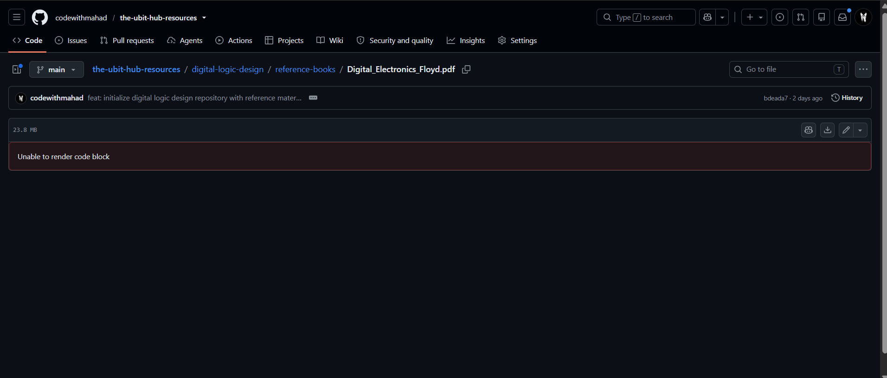

<h1 id="top">
  
  <picture>
    <source media="(max-width: 600px) and (prefers-color-scheme: dark)" srcset="assets/readme/intro-title-compact-dark.svg">
    <source media="(max-width: 600px)" srcset="assets/readme/intro-title-compact-light.svg">
    <source media="(prefers-color-scheme: dark)" srcset="assets/readme/intro-title-dark.svg">
    
  </picture>
</h1>

**Study resources for UBIT students at the University of Karachi.**

Good material often gets buried in old class chats. This library keeps it organized by course: **handwritten and typed notes, revision guides, MCQ practice, and textbook chapters**. Each subject guide explains what is available and where to start.

As part of **The UBIT Hub**, I organize these resources for students across batches and degree programs. Useful material should stay easy to find after the semester ends.

<p>
  <a href="#find-your-course">Courses</a>&nbsp;·
  <a href="#the-dsa-blueprint">DSA&nbsp;Blueprint</a>&nbsp;·
  <a href="#ubit-results-portal">Results&nbsp;&amp;&nbsp;GPA</a>&nbsp;·
  <a href="#how-to-use-the-material">Study&nbsp;guide</a>&nbsp;·
  <a href="#help-improve-the-library">Contribute</a>&nbsp;·
  <a href="#the-ubit-hub">Community</a>
</p>

## Find your course

**6 subjects · 32 PDFs · 1 logic-gates reference sheet.** Open a subject guide for the full file list, or choose a starting document below.

**[Software Requirement Engineering](./resources/software-requirement-engineering/)** &nbsp;·&nbsp; [Course outline](./resources/software-requirement-engineering/SE453_SRE_Course_Outline.pdf) → [Comprehensive notes](./resources/software-requirement-engineering/SE453_SRE_Comprehensive_Notes_ShaikhMahad.pdf)<br>
Typed & handwritten notes · outlines · reference chapters

**[Digital Logic Design](./resources/digital-logic-design/)** &nbsp;·&nbsp; [Final Exam Target Guide](./resources/digital-logic-design/DLD_Final_Exam_Target_Guide.pdf)<br>
Exam guide · handwritten notes · MCQs · Floyd chapters

**[Linear Algebra](./resources/linear-algebra/)** &nbsp;·&nbsp; [Miss Fozia Hanif’s notes](./resources/linear-algebra/linear-algebra-complete-notes-Miss-Fozia-Hanif.pdf)<br>
Complete semester lecture notes

**[Communication & Presentation Skills](./resources/communication-and-presentation-skills/)** &nbsp;·&nbsp; [Complete course notes](./resources/communication-and-presentation-skills/notes/CPS_Complete_Notes.pdf)<br>
Course notes · Murphy & Guffey references

**[Urdu](./resources/urdu/)** &nbsp;·&nbsp; [Comprehensive notes](./resources/urdu/notes/Urdu_Comprehensive_Notes_ShaikhMahad.pdf)<br>
Comprehensive notes · ghazals · selected prose

**[Data Structures & Algorithms](./resources/data-structures-and-algorithms/)** &nbsp;·&nbsp; [The DSA Blueprint](./resources/data-structures-and-algorithms/roadmaps/The-DSA-Blueprint-Roadmap.pdf)<br>
Learning roadmap · practice links · printable study tracker

<details>
<summary><strong>New here? How to find and download material</strong></summary>

1. Open a **subject name** above for its guide and complete file list.
2. Open a **starting document** beside it to go straight to a recommended PDF.
3. Read it in your browser, or use the file viewer’s **download button** to save it.

You do not need to clone the repository or install programming tools to use the material. Check your current course outline before planning revision.

</details>

<details>
<summary><strong>Repository structure</strong></summary>

```text
.
├── resources/
│   ├── README.md
│   ├── communication-and-presentation-skills/
│   ├── data-structures-and-algorithms/
│   │   └── roadmaps/
│   │       └── The-DSA-Blueprint-Roadmap.pdf
│   ├── digital-logic-design/
│   ├── linear-algebra/
│   ├── software-requirement-engineering/
│   └── urdu/
├── assets/
│   └── readme/
├── docs/
├── CONTRIBUTING.md
├── LICENSE
└── README.md
```

This is a folder overview. Open the [subject directory](./resources/) or a subject’s README for its complete file list. New subjects belong inside `resources/`, keeping the repository root compact.

</details>

## The DSA Blueprint

<picture>
  <source media="(prefers-color-scheme: dark)" srcset="assets/readme/dsa-tree-dark.svg">
  
</picture>

**A starting point for students learning Data Structures & Algorithms.**

I wrote **The DSA Blueprint** to give students a clear order to follow after learning programming basics. It moves through problem-solving patterns and data structures, from arrays and linked lists to trees, graphs, and dynamic programming.

The **31-page roadmap** includes six phases, linked practice problems, resource recommendations, and a **16-week printable tracker**.

**[Read the roadmap →](./resources/data-structures-and-algorithms/roadmaps/The-DSA-Blueprint-Roadmap.pdf)** &nbsp;·&nbsp; [See the study guide](./resources/data-structures-and-algorithms/)

## UBIT Results Portal

**A results and GPA website I’m building for UBIT students.**

I built **UBIT Results** so students can check available results, view their GPA, and use a GPA calculator in one place.

**Still in development.** I’m continuing to improve the portal and the experience for students.

<p>
  <a href="https://ubit-results.vercel.app/"></a>
</p>

## How to use the material


1. **Check your scope.** Read the course guide and compare the material with your current outline and your teacher’s instructions.
2. **Work through the notes.** Start with the main notes. Try examples, diagrams, or practice questions yourself before checking the explanations.
3. **Fill the gaps.** Use extracted chapters for specific topics and the full reference books for more detail or practice.

<details>
<summary>A PDF will not preview on GitHub?</summary>

Use the **download button** in the file viewer and open the PDF locally. A failed preview does not necessarily mean the file is missing or damaged.



</details>

## Help improve the library

A clearer set of notes, a missing topic, or a corrected description can make a course folder much more useful.

- **Share material:** follow the [contributing guide](./CONTRIBUTING.md). Add a readable file and a short description to the course README, including its author or source.
- **Report a problem:** [open an issue](https://github.com/codewithmahad/the-ubit-hub-resources/issues/new) with the course, filename, and what needs attention. You can also suggest a course or resource that is missing.

Keep additions clearly named, credited, and free of duplicates. A new course should come with its own guide so the next student knows where to begin.

<h2 id="the-ubit-hub">The UBIT Hub</h2>

**The UBIT Hub** is the WhatsApp community I founded for course updates, academic discussions, shared resources, and peer support. This library and the results portal grew out of that work.

If this library saves you time, **[give it a star](https://github.com/codewithmahad/the-ubit-hub-resources)** and share the subject link with a classmate. **[Follow my work](https://github.com/codewithmahad)** for more resources and student projects.

## Credits & contact

The material here includes work by students, teachers, and published authors. Check the course guides and source documents for attribution and usage information. For a missing credit or a removal request, [email me](mailto:codewithmahad@gmail.com).

<p><sub>Maintained by <a href="https://github.com/codewithmahad">Shaikh Mahad Ud Din</a> &nbsp;·&nbsp; <a href="./LICENSE">Repository license</a> &nbsp;·&nbsp; <a href="#top">Back to top ↑</a></sub></p>
