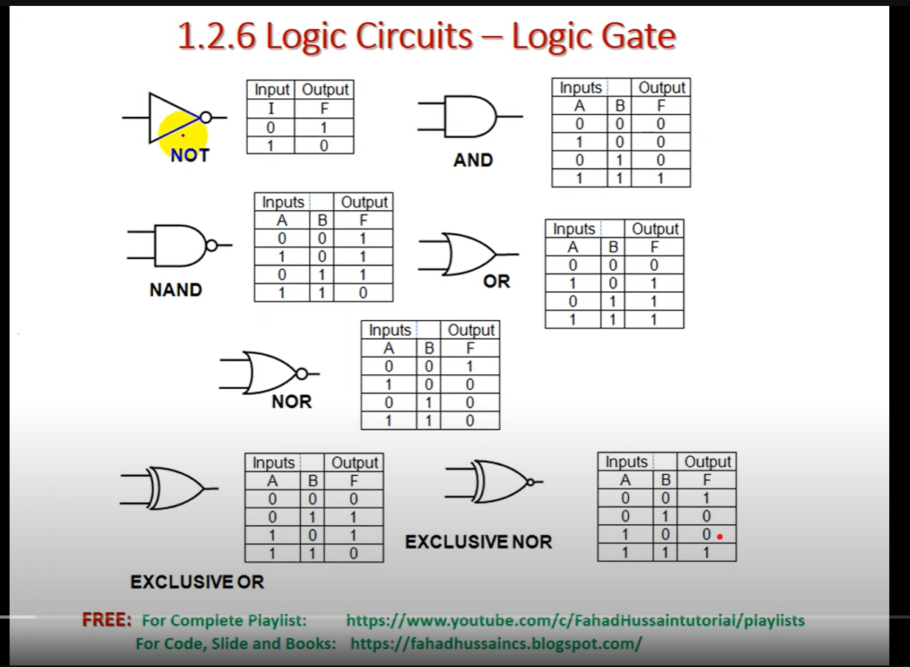

# Digital Logic Design

Lecture notes, revision practice, and a logic-gates reference. Check the teacher and coverage before choosing a set.

## Sir Bari

**[Final Exam Target Guide](./sir-bari/exam-guide/DLD_Final_Exam_Target_Guide.pdf)** · Revision guide · [Set details](./sir-bari/exam-guide/)

Priorities and a checklist based on Sir Bari’s course. Compare it with your current outline; it is a study aid, not a prediction of your exam. The guide’s author and term have not yet been recorded.

## Teacher not yet recorded

These files are preserved separately until their teaching context is confirmed. Do not assume they are all from the same class or teacher.

- **[Mahad’s handwritten notes](./teacher-not-recorded/shaikh-mahad-notes/DLD_Handwritten_Notes_ShaikhMahad.pdf):** circuit diagrams, truth tables, K-map examples, and worked steps. [Set details](./teacher-not-recorded/shaikh-mahad-notes/).
- **[Classmate’s handwritten notes](./teacher-not-recorded/classmate-notes/DLD_Handwritten_Notes_Classmate.pdf):** another student’s explanations and diagrams. Public credit preference has not been confirmed. [Set details](./teacher-not-recorded/classmate-notes/).
- **[MCQ practice](./teacher-not-recorded/mcq-practice/DLD_MCQs_Bank.pdf):** questions for reviewing topics and finding gaps. Author not yet recorded. [Set details](./teacher-not-recorded/mcq-practice/).

## General reference

**[Logic gates and truth tables](./general/logic-gates/logic_gates_cheatsheet.png)** · [Source details](./general/logic-gates/)

View the reference sheet

## Study with these notes

Compare the topics with your outline: number systems, logic gates, Boolean algebra, K-maps, combinational circuits, sequential circuits, registers, and counters.

Draw each circuit and work through the calculations yourself. Try practice questions before checking answers. For fuller textbook explanations, use your library or an authorized copy.

After attempting a K-map, you can check your result with the [K-map solver](https://karnaughmapsolver.com/).

[Share another set](../../CONTRIBUTING.md) · [All courses](../README.md) · [Back to the notes bank](../../README.md)
